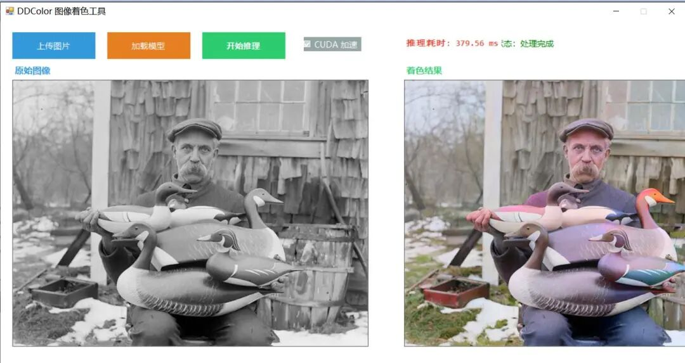

# Implement Image Coloring with Grayscale to Colormap using lightweight ONNX model based on C# Winform

# Implementing Image Colorization with Grayscale to Colormap on Windows Forms using the lightweight ONNX model based on C++

A colorization tool for grayscale images based on deep learning, using the DDColor (Decoupled Diffusion Colorization) model to intelligently restore color from grayscale images.

### Effect Display



Insert image description here.


Insert image description here.

### Algorithm Principles

#### DDColor Model Overview

DDColor is an image coloring algorithm based on diffusion models, which achieves high-quality black and white image coloring by decoupling the diffusion process. The model operates in the Lab color space, with the main workflow as follows:

#### Core Processing Flow

1.

1. **Color Space Conversion**

-

• Convert input image from BGR to RGB color space

-

• RGB to Lab color space conversion, extracting the L channel (brightness channel, range 0-100)

-

• L channel represents the grayscale information of an image

1.

2. **Model Input Preprocessing**

-

• Scale the L channel to match the model input size (512×512)

-

• Construct a three-channel Lab image: L channel is the scaled brightness, and a and b channels are initialized to 0.

-

• Convert the Lab→RGB to obtain grayscale RGB image as input for the model.

-

• Normalize to [0, 1] range and convert to CHW format of floating-point tensor

1.

3. ONNX inference

-

• Input tensor shape: [1, 3, 512, 512] (batch size = 1, 3 channels, height = 512, width = 512)

-

• Model output shape: [1, 2, 512, 512] (Batch size = 1, Channels a and b are 2, Height = 512, Width = 512)

-

• Output the a and b color channels with predictions

1.

4. **Post-processing**

-

• Reconstruct the a and b channels into dual-channel Mat image

-

• Use bilinear interpolation to scale the ab channel to the original image size.

-

• Merge the original L channel with the predicted ab channel to obtain a complete Lab image

-

• Lab→RGB→BGR conversion, to obtain the final color image

-

• Pixel values are scaled from [0, 1] to [0, 255], converted to 8UC3 format

#### Technological Advantages

-

• **High-Quality Shading**: Based on diffusion model, generate natural and realistic colors

-

• **Semantic Understanding**: Capable of understanding image content and assigning appropriate colors.

-

• **Flexible Deployment**: Supports CPU and CUDA GPU inference

-

• **Efficient Reasoning**: Accelerates inference speed with ONNX Runtime.

### Environmental Requirements

#### Development Environment

-

• **Operating System**: Windows 10/11 (x64)

-

• **IDE**: Visual Studio 2019 or higher version

-

• **.NET Framework** : 4.7.2

-

• **C# Language Version**: C# 6.0

#### Dependencies

-

• OpenCvSharp: 4.13.0 (Image Processing)

-

• ONNX Runtime: 1.20.1 (Model Inference)

-

• **CUDA** (optional): 12.x (GPU acceleration)

-

• **cuDNN** (optional): 9.x (GPU acceleration)

#### Hardware Requirements

-

• **CPU Mode**: Any x64 processor, recommended to have 4 cores or more.

-

• **GPU Mode**: NVIDIA GPU (supports CUDA 12.x), recommended more than 4GB of memory.

-

• **Memory**: At least 4GB RAM

-

• **Storage**: At least 500MB of available space

### Installation Steps

#### 1. Clone or download the project

```
# If using Git
git clone <repository-url>
cd FIRC
```

Or directly download the project zip file and extract it.

#### 2. Preparing Model Files

Place the DDColorONNX model file into the `weights` folder:

```
weights/
  └── ddcolor_paper_tiny.onnx
```

**Note**: The model file needs to be downloaded separately. Please obtain the `ddcolor_paper_tiny.onnx` file from official channels.

#### 3. Check Dependencies on DLL

Ensure that the `bin\x64\Release` folder contains the following necessary files:

-

• OpenCvSharp.dll and related DLLs

-

• Microsoft.ML.OnnxRuntime.dll

-

• CUDA-related DLLs (e.g., when using GPU): cudart64_12.dll, cublas64_12.dll, etc.

-

• OpenCvSharpExtern.dll (located in dll\x64 folder)

4. Open the project using Visual Studio

1.

1. Double-click the `FIRC.sln` file to open the project using Visual Studio 2019.

1.

2. Wait for NuGet package to be restored (if using NuGet to manage dependencies)

1.

3. Check if the reference items are normal

5. Compilation Project

1.

1. In Visual Studio, select the configuration to be `Release`, and the platform to be `x64`.

1.

2. Click on the menu: `Generate` → `Generate Solution` (or press `Ctrl+Shift+B`).

1.

3. Ensure there are no compilation errors.

### Running Steps

### Method 1: Visual Studio Execution

1.

1. Run debugging in Visual Studio by pressing F5, or directly run by pressing Ctrl+F5.

1.

2. The main interface will be displayed after the program starts.

### Method 2: Run the executable file directly.

1.

1. Enter the `bin\x64\Release` folder.

1.

2. Double-click to run `FIRC.exe`

#### Usage Process

1.

1. **Load the model**

-

• Check or uncheck the "CUDA Acceleration" checkbox (select based on hardware)

-

• Click the "Load Model" button

-

• Wait for the status bar to display "Model has been loaded [CPU]" or "Model has been loaded [CUDA]"

1.

2. **Upload Images**

-

• Click the "Upload Image" button

-

• Select the grayscale image to be colored (supports .bmp, .jpg, .jpeg, .tiff, .png format)

-

• The image will be displayed in the left "Original Image" area

1.

3. **Starting the Reasoning**

-

• Click the "Start Reasoning" button

-

• Wait for the inference to complete.

-

• The coloring result will be displayed in the right-hand "Coloring Result" area.

-

• Duration information displayed above the interface

1.

4. **Save the result**

-

• Right-click on the result image on the right side, and you can save the colored image.

### Notes

#### Model-related

1.

1. **Model File**: Ensure that the `ddcolor_paper_tiny.onnx` file exists in the `weights` folder.

1.

2. **Model Version**: Different models (tiny/small/base) have different inference speeds and effects.

1.

3. **Input Size**: The current configuration model input size is 512×512, which can be modified in `DDColor.cs` by changing the constant `ModelInputSize`.

#### Hardware-related

1.

1. **CUDA Support**:

-

• Requires NVIDIA GPU and has the correct CUDA 12.x driver installed.

-

• Initialization overhead may be slower for the first time using CUDA.

-

• If CUDA initialization fails, the program will automatically fall back to CPU mode.

1.

2. **Memory Usage**:

-

• Large-sized images will occupy more memory.

-

• Suggestions to handle image dimensions not exceeding 4000×4000 pixels

#### Usage suggestions

1.

1. **Image Format**: It is recommended to use lossless format (PNG) for the best results.

1.

2. **Grayscale Image**: The model performs best on actual grayscale images.

1.

3. **Batch Processing**: The current version supports single-image processing, but batch processing requires modification of the code.

1.

4. **Exception Handling**: If the inference fails, please check whether the model file is complete and if all dependencies are present.

#### Common Issues

**Q: "Model file does not exist" prompt.**
A: Check if there is a `ddcolor_paper_tiny.onnx` file in the `weights` folder.

**Q: CUDA acceleration is not working?**

-

• Confirm the installation of NVIDIA GPU drivers.

-

• Confirm that the `bin\x64\Release` folder contains CUDA-related DLLs.

-

• Check if the CUDA version is 12.x

**Q: Slow reasoning speed?**

-

• Slow CPU mode inference is a normal phenomenon.

-

• Suggest using CUDA GPU acceleration.

-

• Consider using a smaller model (e.g., ddcolor_paper_tiny)

**Q: Compilation error message indicating missing references?**
A: Check if the DLL path in the project references is correct, and ensure all dependent files exist.

### Folder Structure

```
FIRC/
│
├── FIRC.sln  # Visual Studio solution file
├── FIRC.csproj               # Project configuration file
├── FIRC.csproj.user  # User project configuration
├── App.config  # Application configuration file
├── Program.cs  # Program entry point
│
├── Form1.cs  # Main form logic code
├── Form1.Designer.cs  # Main form designer code
├── Form1.resx  # Main form resource file
│
├── DDColor.cs  # DDColor image coloring inference class (core)
│
├── Properties/  # Project Attributes Folder
├── AssemblyInfo.cs # Program Metadata
│ ├── Resources.Designer.cs  # Resource Designer
├── Resources.resx # resource file
├── Settings.Designer.cs # Set the Designer
└── Settings.settings # Application settings
│
├── weights/  # Model weight folder
└── ddcolor_paper_tiny.onnx # DDColor ONNX model file
│
├── images/               # Test image folder
├── gray_faces/  # Grayscale face test images
├── whole_imgs/ # Complete image test set
├── cropped_faces/ # Crop face images
└── masked_faces/ # Masked Face Images
│
├── bin/ # Compilation and output folder
│   └── x64/
Release/ └── #64-bit release version
├── FIRC.exe # The main program executable file
├── FIRC.pdb # Program Debugging Database
├── *.dll # Dependency library files
├── dll/x64/ # OpenCV external DLL
│           │   ├── OpenCvSharpExtern.dll
│           │   └── opencv_videoio_ffmpeg4130_64.dll
│ └── weights/ # Runtime Model Folder (Copy)
│               └── ddcolor_paper_tiny.onnx
```

### Core Class Descriptions

#### DDColor Class

Located in `DDColor.cs`, it is the core inference class of the project:

-

• LoadModel(modelPath, useCuda) : load ONNX model

-

• **Colorize(inputImage)** : Perform image colorization inference

-

• IsModelLoaded: Check if the model has been loaded

-

• Dispose() : Release resources

#### Form1 Class

Located in `Form1.cs`, it is the main form class:

-

• Responsible for user interface interaction

-

• Infer using the DDColor class.

-

• Display input/output images and time-consuming statistics

### Technical Support

If you have any questions or suggestions, please contact us through the following methods:

-

• Submit Issue

-

• Send an email to the project maintainer

### License

This project is for learning and research purposes only. When using this project, please comply with relevant laws and regulations.

### References

-

• DDColor original paper

-

• ONNX Runtime documentation

-

• OpenCvSharp documentation

---


## Payment

Here is a pay link on Stripe ( https://buy.stripe.com/3cs8yP7sY87d0vu9AB ). Please contact me lonlonago@foxmail.com after funding $89, and I will send you a complete data files , thank you!


